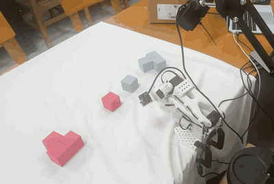

# ECE371 Final Project · SO-101 Manipulation with LeRobot

We trained and evaluated imitation-learning policies on a physical SO-101 arm using Hugging Face LeRobot.

- **Task 1 · Pick and place.** The arm uses ACT to pick up a block from the workbench and place it at a target location.
- **Task 2 · Language-conditioned color sorting.** A single SmolVLA policy follows a text instruction to pick up a red or blue block and place it on the matching stack.

*Task 2 on the physical SO-101 arm, shown at 2× speed.*

## Real-robot success rates

Each setting was evaluated over 15 trials in the original, training-like environment. Confidence intervals are 95% Wilson intervals. Completion times are mean ± standard deviation over successful trials.

### Table 2 · Task 1 (ACT)

| Setting | Successes / trials | Success rate | 95% CI | Completion time (s) |
| --- | ---: | ---: | ---: | ---: |
| E0 · Baseline | 10 / 15 | 66.7% | 41.7–84.8% | 13.96 ± 1.11 |
| E1 · Photometric | 11 / 15 | 73.3% | 48.0–89.1% | 13.49 ± 0.90 |
| E2 · Photometric + geometric | 9 / 15 | 60.0% | 35.7–80.2% | 14.46 ± 1.10 |

### Table 3 · Task 2 (SmolVLA)

| Setting | Successes / trials | Success rate | 95% CI | Wrong-color placements | Completion time (s) |
| --- | ---: | ---: | ---: | ---: | ---: |
| E0 · Baseline | 8 / 15 | 53.3% | 30.1–75.2% | 1 / 15 (6.7%) | 16.00 ± 1.00 |
| E1 · Photometric | 9 / 15 | 60.0% | 35.7–80.2% | 0 / 15 (0.0%) | 16.11 ± 0.99 |
| E2 · Photometric + geometric | 6 / 15 | 40.0% | 19.8–64.3% | 2 / 15 (13.3%) | 16.83 ± 1.21 |

## Datasets

The demonstrations use LeRobot Dataset v3. Task 2 combines the two color datasets into a single 62-episode training dataset with a separate instruction for each color.

| Task | Episodes | Hugging Face dataset |
| --- | ---: | --- |
| Task 1 · Pick and place | 83 | [Valaris1028/task1_grab_place_new_merged_83](https://huggingface.co/datasets/Valaris1028/task1_grab_place_new_merged_83) |
| Task 2 · Red block | 31 | [Valaris1028/task2_pick_red_merged_31](https://huggingface.co/datasets/Valaris1028/task2_pick_red_merged_31) |
| Task 2 · Blue block | 31 | [Valaris1028/task2_pick_blue_merged_31](https://huggingface.co/datasets/Valaris1028/task2_pick_blue_merged_31) |

## Team

| Member | Contributions |
| --- | --- |
| **Guo Yi** (team lead) | Set up LeRobot, managed the datasets, ran initial ACT training, and led slide preparation. |
| **He Jialiang** | Set up the test bench and evaluation environment, trained Task 1 ACT and ran its augmentation ablation, reviewed failure videos, and contributed to the slides. |
| **Zhang Qi** | Trained Task 2 SmolVLA and ran its augmentation ablation, monitored training loss, helped collect Task 2 demonstrations and set up the test bench, and evaluated Task 2 on the robot. |
| **Chen Cai** | Assembled and wired the SO-101, calibrated the arm and configured both cameras, collected teleoperated demonstrations, ran real-robot evaluations, and contributed to the presentation. |
